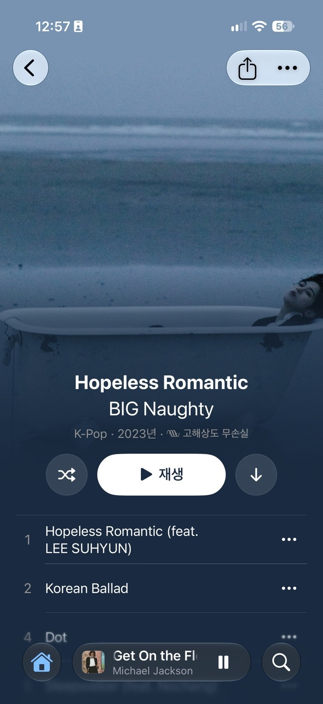

<p align="center">
  
</p>

<h1 align="center">Luma Music</h1>

<p align="center"><strong>Your music. The experience it deserves.</strong></p>
<p align="center">A beautiful, native listening experience for the music you own.</p>
<p align="center">
  <a href="#a-closer-look">Take a look</a>
  &nbsp; · &nbsp;
  <a href="#download--installation">Get the IPA</a>
  &nbsp; · &nbsp;
  <a href="https://github.com/GimGyumin/Luma-Music/issues">Share feedback</a>
</p>

<p align="center"><sub>For Navidrome · OpenSubsonic-compatible servers · Supported Jellyfin libraries</sub></p>

---

## A closer look

<p align="center">
  
  
  
</p>
<p align="center"><sub>Now Playing &nbsp; · &nbsp; Lyrics & translation &nbsp; · &nbsp; Pronunciation</sub></p>

<p align="center">
  
  
</p>
<p align="center"><sub>Album experience &nbsp; · &nbsp; Lock Screen</sub></p>

---

## Beautifully yours.

Bring your personal music library to life with an **artwork-first interface**, thoughtful motion, and the familiarity of a native Apple-platform app. Designed to feel at home on iPhone and iPad, with a Mac project available to build from source.

Immersive presentation can extend from albums to Now Playing and supported Lock Screen experiences. **Some album covers do not support immersive artwork**, and system features depend on the device and signing configuration.

## Every word matters.

Follow the music with smooth, synchronized lyrics, including **TTML word-timed highlighting** when the connected server or a compatible source provides the necessary data.

Optional Apple or OpenAI-powered translation makes available lyric text easier to understand. **Pronunciation and romanization are displayed only when the lyric data includes a compatible pronunciation layer.** Luma does not generate that layer for every song.

Lyrics are available only when the server holds or supplies compatible lyric data, or when an enabled external source such as LRCLIB can provide it. Translation, precise timing, and pronunciation each have their own data requirements.

## Hear the album as intended.

From the first note to the last, Luma focuses on uninterrupted listening.

- **Gapless playback** for supported albums and live recordings.
- **Lossless streaming** where the source, server, and playback route support it.
- **Crossfade and ReplayGain**, playback queue management, shuffle, and repeat.
- **Offline downloads**, adaptive streaming, caching, and network recovery.

## Thoughtful in every detail.

Responsive browsing, local library indexing, artwork caching, and performance-aware visual effects help keep the experience fluid. Luma also offers supported Siri and Shortcuts actions, Spotlight search, widgets, and system playback controls.

Accessibility and privacy matter too: VoiceOver, Dynamic Type, Reduce Motion, English/Korean localization, and **no built-in analytics or telemetry**.

> Actual battery use varies with brightness, device, connectivity, media format, and output. Luma does not claim independently verified battery-life superiority over other players.

---

## Download & installation

**IPA distribution only.** The next IPA build will be uploaded **separately, after this GitHub page refresh**; it is not part of this README update. The Releases page may still contain an older preview build.

**[View available IPA releases](https://github.com/GimGyumin/Luma-Music/releases)**

To get started once the new build is published:

1. Download the IPA from [GitHub Releases](https://github.com/GimGyumin/Luma-Music/releases).
2. Sign and install it on a compatible iPhone or iPad with a sideloading tool such as SideStore or AltStore.
3. Connect Luma Music to **your own music server** and sign in.

**There is currently no App Store or TestFlight distribution.** Luma does not include a commercial music catalog; a compatible self-hosted server and music library are required. Sideloading requires a compatible signing method, and some system integrations may need specific entitlements.

### Compatibility

| Platform | Minimum version |
| --- | --- |
| iPhone | iOS 18.6 |
| iPad | iPadOS 18.6 |
| Mac | macOS 15.6 (build from source) |

**Music servers:** Navidrome, OpenSubsonic-compatible servers, and supported Jellyfin libraries.

**Playback formats:** MP3, AAC, FLAC, Ogg Vorbis, Opus, and WAV through supported playback routes. Available codecs, lyrics, artwork, transcoding, and integrations depend on the server and device.

### Build from source

Requires a Mac with **Xcode 26 or later** and a suitable development signing configuration.

```bash
git clone https://github.com/GimGyumin/Luma-Music.git
cd Luma-Music
open Luma.xcodeproj
```

Choose the **Luma** scheme, configure **Signing & Capabilities**, and let Swift Package Manager resolve dependencies. Audio and background-playback behavior should be tested on a physical device. The iOS/iPadOS IPA is not a standalone Mac installer.

---

## Your library stays yours.

Luma Music connects to the server you choose, stores server credentials in the system Keychain, and does not include built-in advertising, analytics, or tracking SDKs.

**Optional external services**

- **LRCLIB lyrics fallback:** May send song title, artist, album, and duration when enabled. To disable it, choose **Settings → Lyrics → Source → Server only**.
- **OpenAI translation:** When selected and configured, sends lyric text to the translation provider. Available Apple translation options depend on supported system capabilities.
- **Metadata:** Optional lookups through MusicBrainz, Wikidata, Wikipedia, or Cover Art Archive may send artist and album information.

Unencrypted HTTP connections require explicit confirmation and may expose traffic on untrusted networks; use HTTPS where possible.

## Made to grow with your music.

Luma Music is open source. Feedback, bug reports, and contributions are welcome.

[Report an issue](https://github.com/GimGyumin/Luma-Music/issues) &nbsp; · &nbsp; [Contributing guide](CONTRIBUTING.md) &nbsp; · &nbsp; [Releases](https://github.com/GimGyumin/Luma-Music/releases)

---

## 📜 Credits & Licensing

Luma Music is an **AI-assisted, open-source music player developed from the Cassette project**.

### Acknowledgements

- **Cassette** — Mozilla Public License 2.0 (MPL-2.0).
- **Apple Music Like Lyrics (AMLL)** — GNU Affero General Public License v3.0 only (AGPL-3.0-only).

The repository's root license is **Mozilla Public License 2.0 (MPL-2.0)**. The repository also contains components governed by different licenses; the root license **does not relicense AMLL-derived code**.

Distribution of combined application binaries requires compliance with all applicable license terms. Because the application links AMLL-derived code, distributing the combined work must also satisfy applicable AGPL-3.0 requirements, including corresponding-source obligations.

For copyright attribution and third-party licensing details, see:

- [LICENSE](LICENSE)
- [NOTICE](NOTICE)
- [COPYRIGHT](COPYRIGHT)
- [THIRD_PARTY_NOTICES.md](THIRD_PARTY_NOTICES.md)

> **Licensing note:** The exact obligations for a distributed binary depend on the components and their manner of combination. Review the applicable licenses before redistribution.

---

<p align="center"><strong>Luma Music</strong><br><em>Your music. The experience it deserves.</em></p>
