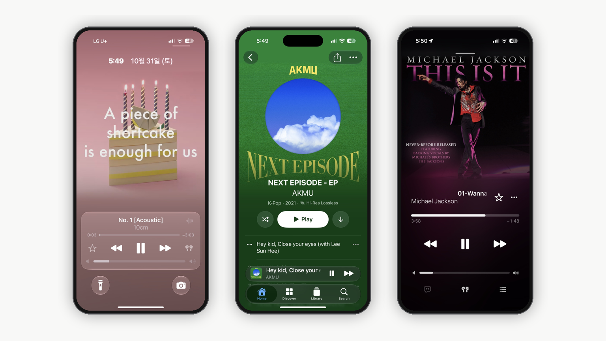

  
# Luma Music

**Your music, beautifully.**

*A beautiful, native music experience for your personal library on iPhone, iPad, and Mac.*

Luma Music is an AI-assisted, open-source music player for **Navidrome**, **OpenSubsonic-compatible servers**, and **supported Jellyfin libraries**. It brings together high-quality audio streaming, synchronized lyrics, offline listening, and a native, artwork-focused interface inspired by Apple Music.

**Your music. Your server. Your listening experience.**

---

## ✨ Highlights

- **Beautiful native experience** — An artwork-focused interface for iPhone, iPad, and Mac.
- **High-quality audio** — Lossless streaming, gapless playback, crossfade, and ReplayGain.
- **Synchronized lyrics** — Line-by-line and karaoke-style highlighting, with optional translation.
- **Offline listening** — Download songs, albums, and playlists.
- **Powerful search** — Local library indexing, categorized results, and Spotlight integration.
- **Apple integration** — Siri, Shortcuts, widgets, and system playback controls.
- **Reliable connectivity** — Adaptive streaming, caching, and network recovery.
- **Accessibility and privacy** — VoiceOver, Dynamic Type, Reduce Motion, and no built-in analytics or telemetry.

---

## 📥 Download & Installation

**[Download Luma Music 1.0](https://github.com/GimGyumin/Luma-Music/releases)**

Luma Music is distributed through GitHub as an IPA package.

1. Download the IPA from the [Releases page](https://github.com/GimGyumin/Luma-Music/releases).
2. Install it using a compatible sideloading solution, such as SideStore or AltStore.
3. Open Luma Music and connect to your supported music server.
4. Sign in and explore your music library.

> **Installation note:** Sideloading requires a compatible signing method. Certain system integrations may depend on signing entitlements, hardware, and operating-system capabilities.

---

## 🎵 Music Playback

- Lossless playback when supported by the server, source files, and playback configuration.
- Gapless transitions for supported albums and live recordings.
- Crossfade and ReplayGain with clipping protection.
- Automatic streaming quality and manual Lossless, AAC, and Opus options when supported.
- Up Next queue management, shuffle, repeat, and responsive seeking.
- Playback recovery during eligible network interruptions.
- Lock Screen, Control Center, and system Now Playing integration.
- Support for MP3, AAC, FLAC, Ogg Vorbis, Opus, and WAV through compatible playback routes.

## 💿 Music Library

- Browse artists, albums, songs, playlists, and supported radio collections.
- Explore artwork-rich artist and album pages.
- Create and manage supported playlists and sorting options.
- Access recently played and pinned content when enabled.
- Enhance artist and release information through available metadata integrations.
- Configure multiple servers, with one active server at a time.
- Keep downloads and cached content associated with their respective server accounts.

## 🎤 Synchronized Lyrics

- Line-by-line synchronization and karaoke-style word highlighting when timing data is available.
- Smooth lyric scrolling and transitions.
- Server-provided lyrics with optional LRCLIB fallback.
- Optional translation through configured integrations and compatible on-device capabilities.
- Cached lyrics for faster loading and reduced network requests.
- Configurable lyric sources, including a server-only option.

## 🔎 Search & Discovery

- Local indexing for responsive library search.
- Categorized results for songs, albums, artists, and playlists.
- Search history and Spotlight integration.
- Direct navigation from supported Spotlight results into Luma Music.
- Server-aware indexing to keep libraries separate.

## 📶 Offline Listening & Connectivity

- Download songs, albums, and playlists for offline listening.
- Browse downloaded media, artwork, and cached metadata without contacting the server.
- Configure download quality and separate Wi-Fi and cellular streaming preferences.
- Resume or repair interrupted downloads when supported.
- Adaptive streaming, intelligent caching, and network recovery.
- Store server credentials in the system Keychain.

## 🍎 Apple Ecosystem

- Native interfaces for iPhone, iPad, and Mac.
- Siri and Shortcuts support for compatible actions.
- Spotlight search, widgets, and supported Live Activities.
- Lock Screen and Control Center playback controls.
- Background audio and supported background processing.
- English and Korean localization.

## ♿ Accessibility

- VoiceOver labels, hints, and accessibility traits.
- Dynamic Type support for compatible interface elements.
- Reduce Motion and Low Power Mode-aware visual effects.
- Localized accessibility labels in English and Korean.

---

## 🔐 Privacy & Security

**Your library remains under your control.**

Luma Music does not require a separate account and does not include built-in analytics or telemetry. It connects to the music server you configure; downloaded music and cached data are stored locally as needed. Server credentials are stored in the system Keychain.

### External Services

**Lyrics:** When your server does not provide synchronized lyrics, Luma Music may automatically fall back to LRCLIB. This request sends the track title, artist, album, and duration.

To disable that fallback, choose **Settings → Lyrics → Source → Server only**.

**Metadata:** Missing artist or release information may be retrieved from MusicBrainz, Wikidata, Wikipedia, or Cover Art Archive using artist or album names.

These services may receive the relevant music metadata when contacted. Unencrypted HTTP server connections require explicit confirmation because credentials and traffic may be visible on untrusted networks.

---

## 📱 Compatibility

| Platform | Minimum version |
| --- | --- |
| iPhone | iOS 18.6 or later |
| iPad | iPadOS 18.6 or later |
| Mac | macOS 15.6 or later |

### Supported Music Servers

- Navidrome
- OpenSubsonic-compatible servers
- Supported Jellyfin libraries

Available formats, lossless playback, transcoding, artwork, metadata, and lyrics depend on the connected server and source files. Some integrations require compatible hardware, operating systems, or signing capabilities.

---

## 🛠️ Build from Source

### Requirements

- macOS with **Xcode 26 or later**.
- A compatible development environment and signing configuration.

### Clone and Open

```bash
git clone https://github.com/GimGyumin/Luma-Music.git
cd Luma-Music
open Luma.xcodeproj
```

Select the **Luma** scheme, configure your team under **Signing & Capabilities**, and build and run. Swift Package Manager resolves dependencies such as SwiftSonic and AudioStreaming automatically.

> **Audio testing:** FLAC/AAC playback, gapless transitions, and audio-session behavior may differ in the Simulator. Verify audio changes on a physical device.

---

## 🤝 Contributing

Bug reports, suggestions, and pull requests are welcome. Please read [CONTRIBUTING.md](CONTRIBUTING.md) before contributing.

- [Report an issue](https://github.com/GimGyumin/Luma-Music/issues)
- [View pull requests](https://github.com/GimGyumin/Luma-Music/pulls)
- [Browse releases](https://github.com/GimGyumin/Luma-Music/releases)

---

## 📜 Credits & Licensing

Luma Music is an **AI-assisted, open-source music player developed from the Cassette project**.

### Acknowledgements

- **Cassette** — Mozilla Public License 2.0 (MPL-2.0).
- **Apple Music Like Lyrics (AMLL)** — GNU Affero General Public License v3.0 only (AGPL-3.0-only).

The repository's root license is **Mozilla Public License 2.0 (MPL-2.0)**. The repository also contains components governed by different licenses; the root license **does not relicense AMLL-derived code**.

Distribution of combined application binaries requires compliance with all applicable license terms. Because the application links AMLL-derived code, distributing the combined work must also satisfy applicable AGPL-3.0 requirements, including corresponding-source obligations.

For copyright attribution and third-party licensing details, see:

- [LICENSE](LICENSE)
- [NOTICE](NOTICE)
- [COPYRIGHT](COPYRIGHT)
- [THIRD_PARTY_NOTICES.md](THIRD_PARTY_NOTICES.md)

> **Licensing note:** The exact obligations for a distributed binary depend on the components and their manner of combination. Review the applicable licenses before redistribution.

---

## ❤️ About Luma Music

Luma Music brings together the freedom of self-hosted music and the experience of a modern native music player.

**Your music. Your library. Your experience.**

---

**Luma Music — Your music, beautifully.**

*Made for your music. Designed for Apple platforms.*
