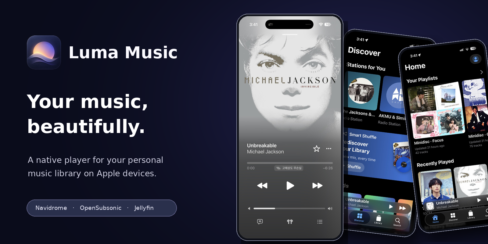
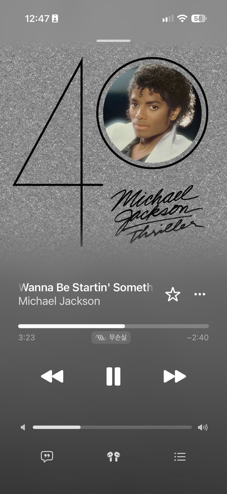
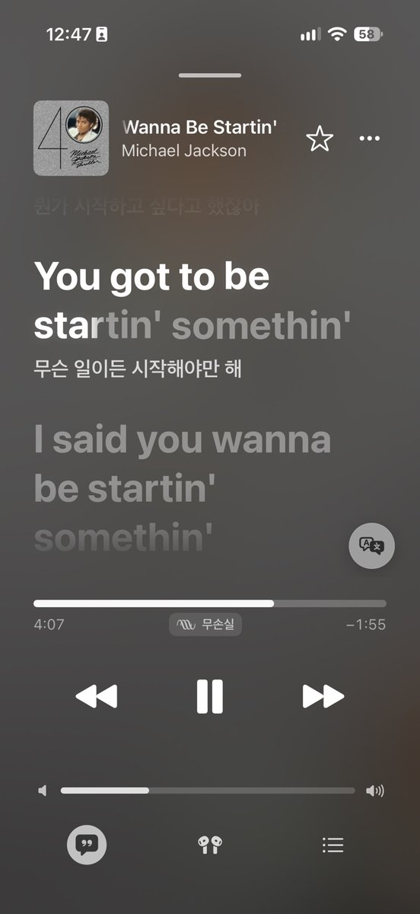
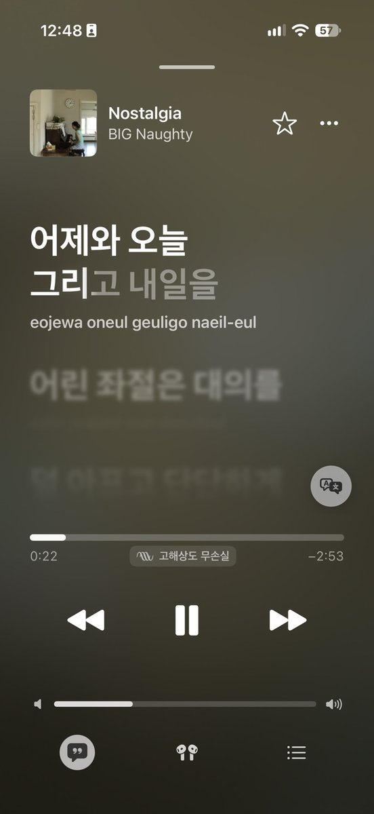
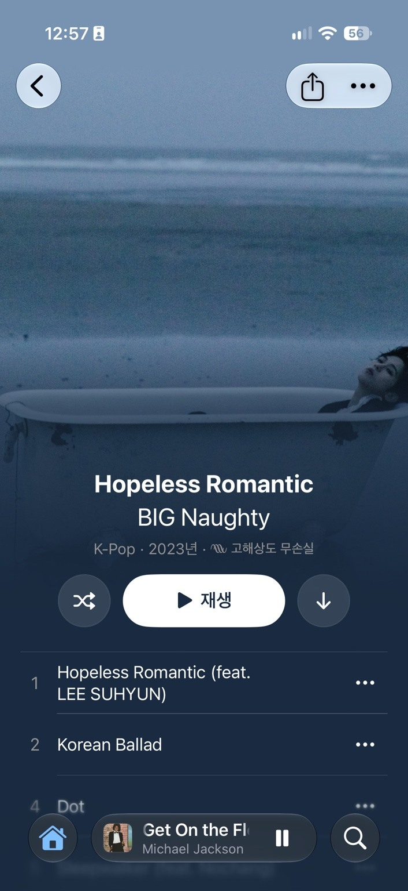
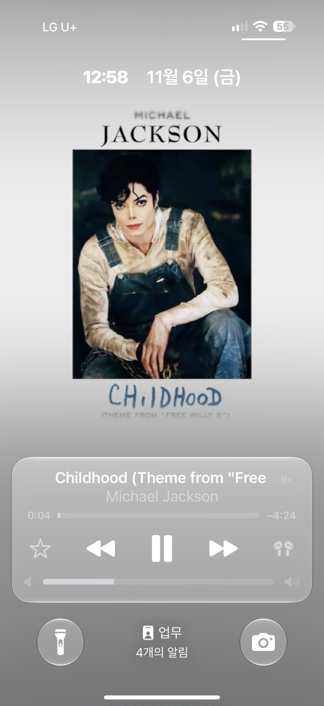

LUMA MUSIC &nbsp; / &nbsp; 1.0 RC3

<h1 align="center">Your music, beautifully.</h1>

Your server. Your collection. An extraordinary way to listen.

A native, open-source music experience for iPhone and iPad.

  <a href="https://github.com/GimGyumin/Luma-Music/releases/tag/v1.0.0-rc3"><strong>Get Luma Music</strong></a>
  &nbsp; · &nbsp;
  <a href="#discover-luma">Explore</a>
  &nbsp; · &nbsp;
  <a href="#whats-next">What's next</a>

<!-- Product film: insert the GitHub user-attachments video URL here on its own line. -->

iOS &amp; iPadOS 18.6 or later &nbsp; · &nbsp; Navidrome &nbsp; · &nbsp; OpenSubsonic &nbsp; · &nbsp; Supported Jellyfin libraries

---

## Discover Luma

<h2 align="center">Feel every note.</h2>

Immersive artwork. Beautifully timed lyrics. A player designed around your music.

  
  
  
  

<h2 align="center">A collection that feels like yours.</h2>

From the albums you love to the music on your Lock Screen.

  
  

Immersive artwork is available for compatible covers and supported devices.

---

## Every detail. In harmony.

| | |
| :--- | :--- |
| **Every word matters.** Word-by-word TTML lyrics, optional translation and pronunciation, and music-reactive lyric backgrounds. | **Hear it all.** Lossless and Hi-Res playback where supported, gapless transitions, Crossfade, and ReplayGain. |
| **Make it yours.** Artwork-focused browsing, library search, queue controls, offline downloads, and caching. | **Naturally at home.** Siri, Shortcuts, Spotlight, widgets, Lock Screen controls, VoiceOver, Dynamic Type, and Reduce Motion. |

RC3 adds English-to-Korean pronunciation fallback for supported words. Lyrics depend on compatible timing data and available sources. Audio quality depends on the source and output route.

Battery use depends on brightness, device, network, media format, and audio output. No independently verified battery-life advantage over other players is claimed.

---

## Get Luma Music

<h2 align="center">Ready when you are.</h2>

<strong>1.0 RC3 · Build 261116</strong>

  <a href="https://github.com/GimGyumin/Luma-Music/releases/tag/v1.0.0-rc3"><strong>Download RC3</strong></a>
  &nbsp; · &nbsp;
  <a href="docs/GETTING_STARTED.md">Installation guide</a>
  &nbsp; · &nbsp;
  <a href="docs/releases/v1.0.0-rc3.md">Release notes</a>

The RC3 source code was published on November 28, 2026. [Browse build 261116 source](https://github.com/GimGyumin/Luma-Music/tree/1797cfb53eaae932ae1136b33ddb6bc675c351c6).

Install the IPA using a compatible sideloading method such as SideStore or AltStore, then connect to your own music server. Luma is a client, not a music server or commercial streaming catalog.

**iPad update:** Previously reported iPad UI issues have been addressed in RC3. RC3 is recommended for iPad users.

**iPad 업데이트 안내:** 기존에 보고된 iPad UI 문제는 RC3에서 수정되었습니다. RC3로 업데이트해 주세요.

---

## What's next

<h2 align="center">The beginning of something beautiful.</h2>

Luma Music 1.0 is scheduled for January 2027.

| Milestone | Target |
| :--- | :--- |
| **RC4** — Final release candidate | Coming soon |
| **Luma Music 1.0** — First stable iOS/iPadOS release | January 2027 |
| **TestFlight** | Later in 2027 |
| **App Store** | Later in 2027 |
| **Dedicated macOS app** | 2027 |

The January release will be distributed through GitHub via sideloading, not through TestFlight or the App Store. TestFlight and App Store releases are planned for later in 2027; there is no confirmed date yet. All targets remain subject to readiness.

**Your interest could bring them closer.** Star the repository, share Luma Music, and tell us what you'd love to see next. Your support could help bring TestFlight and App Store availability forward.

  <a href="https://github.com/GimGyumin/Luma-Music"><strong>Star Luma Music</strong></a>
  &nbsp; · &nbsp;
  <a href="https://github.com/GimGyumin/Luma-Music/discussions">Join the discussion</a>
  &nbsp; · &nbsp;
  <a href="docs/ROADMAP.md">Roadmap</a>

---

## Your library stays yours.

Your server. Your collection. Luma uses the system Keychain for server credentials and has **no built-in advertising SDK**. **Optional Firebase Crashlytics and Performance diagnostics are off by default**. If you enable **Share Diagnostics**, limited crash and performance information may be sent to Firebase. Custom reports exclude song titles, lyrics, account details, server addresses, and credentials. Disabling sharing stops new custom traces immediately, but Firebase collection changes may require an app restart to fully take effect.

Optional integrations can send data when used: LRCLIB fallback may send track metadata; optional OpenAI translation sends lyric text to its provider; metadata searches may use MusicBrainz, Wikidata, Wikipedia, or Cover Art Archive. Apple translation depends on supported system capabilities. To disable LRCLIB fallback, select **Settings → Lyrics → Source → Server only**.

Unencrypted HTTP connections require explicit confirmation. Prefer HTTPS when possible.

[Privacy & support](docs/SUPPORT.md)

## A little better with every release.

We're still polishing Luma Music, its documentation, and this repository. If you like what we're building, **[give the project a ⭐ star](https://github.com/GimGyumin/Luma-Music)**. It helps others discover it.

[Documentation](docs/README.md) &nbsp; · &nbsp; [Roadmap](docs/ROADMAP.md) &nbsp; · &nbsp; [Discussions](https://github.com/GimGyumin/Luma-Music/discussions) &nbsp; · &nbsp; [Report an issue](https://github.com/GimGyumin/Luma-Music/issues/new/choose) &nbsp; · &nbsp; [Contribute](CONTRIBUTING.md)

---

## 📜 Credits & Licensing

Luma Music is an **AI-assisted, open-source music player developed from the Cassette project**. It is an independent third-party client and is not affiliated with Apple.

### Acknowledgements

- **Cassette** — Mozilla Public License 2.0 (MPL-2.0).
- **Apple Music Like Lyrics (AMLL)** — GNU Affero General Public License v3.0 only (AGPL-3.0-only).

The repository's root license is **Mozilla Public License 2.0 (MPL-2.0)**. The repository also contains components governed by different licenses; the root license **does not relicense AMLL-derived code**.

Distribution of combined application binaries requires compliance with all applicable license terms. Because the application links AMLL-derived code, distributing the combined work must also satisfy applicable AGPL-3.0 requirements, including corresponding-source obligations.

For copyright attribution and third-party licensing details, see:

- [LICENSE](LICENSE)
- [NOTICE](NOTICE)
- [COPYRIGHT](COPYRIGHT)
- [THIRD_PARTY_NOTICES.md](THIRD_PARTY_NOTICES.md)

> **Licensing note:** The exact obligations for a distributed binary depend on the components and their manner of combination. Review the applicable licenses before redistribution.

---

<strong>Luma Music</strong> <em>Your music, beautifully.</em>

