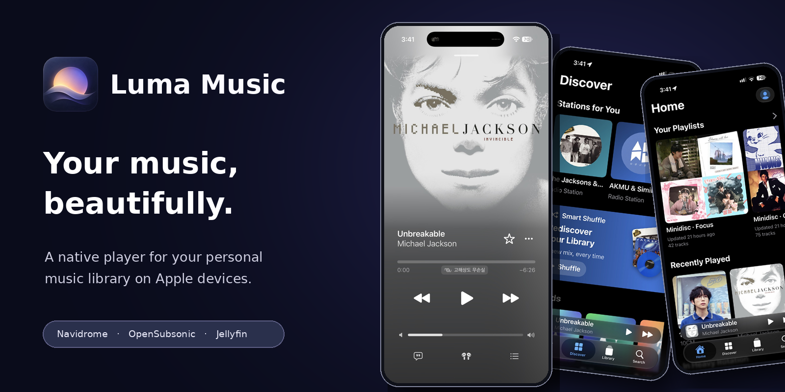
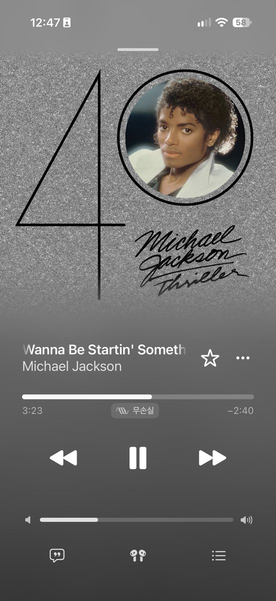
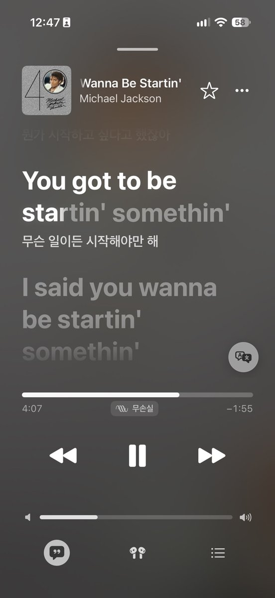
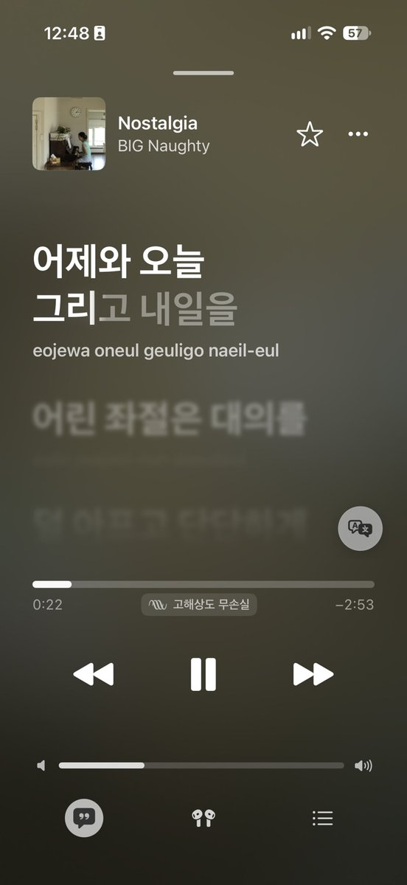
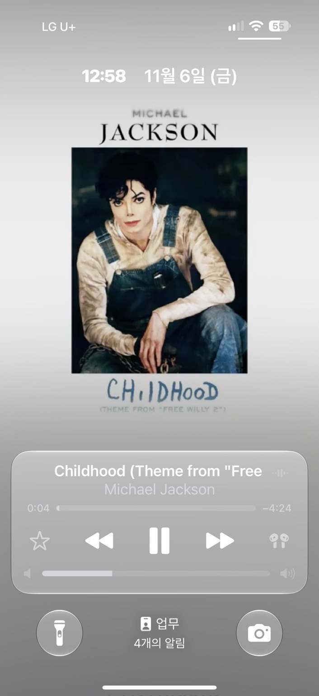

<h1 align="center">Luma Music</h1>

<strong>Your music. The experience it deserves.</strong>

A beautiful, native listening experience for the music you own.

  <a href="#discover-luma">Explore</a> &nbsp; · &nbsp;
  <a href="#get-luma-music">Get Luma</a> &nbsp; · &nbsp;
  <a href="./docs/README.md">Guides</a> &nbsp; · &nbsp;
  <a href="./docs/ROADMAP.md">Roadmap</a> &nbsp; · &nbsp;
  <a href="https://github.com/GimGyumin/Luma-Music/discussions">Community</a>

iPhone & iPad — IPA preview &nbsp; | &nbsp; macOS — Coming next year (2027)

Navidrome · OpenSubsonic-compatible servers · Supported Jellyfin libraries

> **Luma Music 1.0 RC2 · Available now**
>
> RC2 is now available as an **iPhone and iPad IPA preview**. Build 1031 source code has also been published to `main`. This is a release candidate, not the final stable 1.0 release.
>
> [Download RC2 IPA](https://github.com/GimGyumin/Luma-Music/releases/download/v1.0.0-rc2/Luma.1.0.RC2.ipa) &nbsp; · &nbsp; [Release notes](https://github.com/GimGyumin/Luma-Music/releases/tag/v1.0.0-rc2) &nbsp; · &nbsp; [Browse build 1031 source](https://github.com/GimGyumin/Luma-Music/tree/7fd9018f31d63527d49a9d86eebff54367d1a1ea)

---

## Discover Luma

  
  
  

Now Playing &nbsp; · &nbsp; Lyrics & translation &nbsp; · &nbsp; Pronunciation

  
  

Beautiful album pages &nbsp; · &nbsp; Lock Screen controls

---

## Your albums, brought to life.

Your own collection deserves more than a list of tracks. Luma brings an **Apple Music-inspired interface** to your self-hosted library, with immersive artwork, smooth transitions, and native playback controls.

Immersive artwork is available for **compatible covers only**. Some album covers or device capabilities may not support this presentation.

## Every word matters.

Synchronized lyrics move with your music, including **TTML word-timed highlighting** when compatible timing data is available. Optional Apple- or OpenAI-powered translation can help with provided lyric text.

**Pronunciation and romanization appear only when compatible pronunciation data is supplied.** Lyrics themselves depend on your server or an enabled source such as LRCLIB, and are not available for every track.

## Hear it all. Without the gaps.

Gapless playback for supported albums and live recordings. Lossless streaming where the source and audio route allow it. Crossfade, ReplayGain, queue controls, offline downloads, and caching for your everyday listening.

## Thoughtful in every detail.

Library search, responsive artwork, and efficient UI updates. Supported system features include Siri, Shortcuts, Spotlight, widgets, and playback controls, alongside VoiceOver, Dynamic Type, Reduce Motion, and English/Korean localization.

> Battery use depends on brightness, device, network, media format, and audio output. No independently verified battery-life advantage over other players is claimed.

---

## Get Luma Music

**Available now: Luma Music 1.0 RC2 IPA preview for iPhone and iPad.**

**[Download RC2 IPA](https://github.com/GimGyumin/Luma-Music/releases/download/v1.0.0-rc2/Luma.1.0.RC2.ipa)** &nbsp; · &nbsp; **[All releases](https://github.com/GimGyumin/Luma-Music/releases)** &nbsp; · &nbsp; **[Installation guide](docs/GETTING_STARTED.md)**

Download the RC2 IPA, install it with a compatible sideloading method such as SideStore or AltStore, then connect to **your own music server**. Luma is a client, not a music server or a commercial streaming catalog.

**There is currently no TestFlight or App Store distribution.** [RC2](https://github.com/GimGyumin/Luma-Music/releases/tag/v1.0.0-rc2) is the latest publicly available IPA preview; [RC1](https://github.com/GimGyumin/Luma-Music/releases/tag/v1.0.0-rc1) remains available as an earlier version.

| Platform | Availability |
| --- | --- |
| **iPhone** | IPA preview · iOS 18.6 or later |
| **iPad** | IPA preview · iPadOS 18.6 or later |
| **macOS** | **Coming next year (2027)** · Not available |

We're aiming for a **stable 1.0 iPhone/iPad release before the end of 2026**, subject to testing and final readiness. The macOS version is planned for 2027; the current IPA is not a Mac installer.

[Get started](docs/GETTING_STARTED.md) &nbsp; · &nbsp; [Explore features](docs/FEATURES.md) &nbsp; · &nbsp; [Roadmap](docs/ROADMAP.md)

---

## Your library stays yours.

Your server. Your collection. Luma uses the system Keychain for server credentials and has **no built-in advertising SDK**. **Optional Firebase Crashlytics and Performance diagnostics are off by default**. If you enable **Share Diagnostics**, limited crash and performance information may be sent to Firebase. Custom reports exclude song titles, lyrics, account details, server addresses, and credentials. Disabling sharing stops new custom traces immediately, but Firebase collection changes may require an app restart to fully take effect.

Optional integrations can send data when used: LRCLIB fallback may send track metadata; optional OpenAI translation sends lyric text to its provider; metadata searches may use MusicBrainz, Wikidata, Wikipedia, or Cover Art Archive. Apple translation depends on supported system capabilities. To disable LRCLIB fallback, select **Settings → Lyrics → Source → Server only**.

Unencrypted HTTP connections require explicit confirmation. Prefer HTTPS when possible.

[Privacy & support](docs/SUPPORT.md)

## A little better with every release.

We're still polishing Luma Music, its documentation, and this repository. If you like what we're building, **[give the project a ⭐ star](https://github.com/GimGyumin/Luma-Music)**. It helps others discover it.

[Documentation](docs/README.md) &nbsp; · &nbsp; [Roadmap](docs/ROADMAP.md) &nbsp; · &nbsp; [Discussions](https://github.com/GimGyumin/Luma-Music/discussions) &nbsp; · &nbsp; [Report an issue](https://github.com/GimGyumin/Luma-Music/issues/new/choose) &nbsp; · &nbsp; [Contribute](CONTRIBUTING.md)

---

## 📜 Credits & Licensing

Luma Music is an **AI-assisted, open-source music player developed from the Cassette project**.

### Acknowledgements

- **Cassette** — Mozilla Public License 2.0 (MPL-2.0).
- **Apple Music Like Lyrics (AMLL)** — GNU Affero General Public License v3.0 only (AGPL-3.0-only).

The repository's root license is **Mozilla Public License 2.0 (MPL-2.0)**. The repository also contains components governed by different licenses; the root license **does not relicense AMLL-derived code**.

Distribution of combined application binaries requires compliance with all applicable license terms. Because the application links AMLL-derived code, distributing the combined work must also satisfy applicable AGPL-3.0 requirements, including corresponding-source obligations.

For copyright attribution and third-party licensing details, see:

- [LICENSE](LICENSE)
- [NOTICE](NOTICE)
- [COPYRIGHT](COPYRIGHT)
- [THIRD_PARTY_NOTICES.md](THIRD_PARTY_NOTICES.md)

> **Licensing note:** The exact obligations for a distributed binary depend on the components and their manner of combination. Review the applicable licenses before redistribution.

---

<strong>Luma Music</strong> <em>Your music. The experience it deserves.</em>

